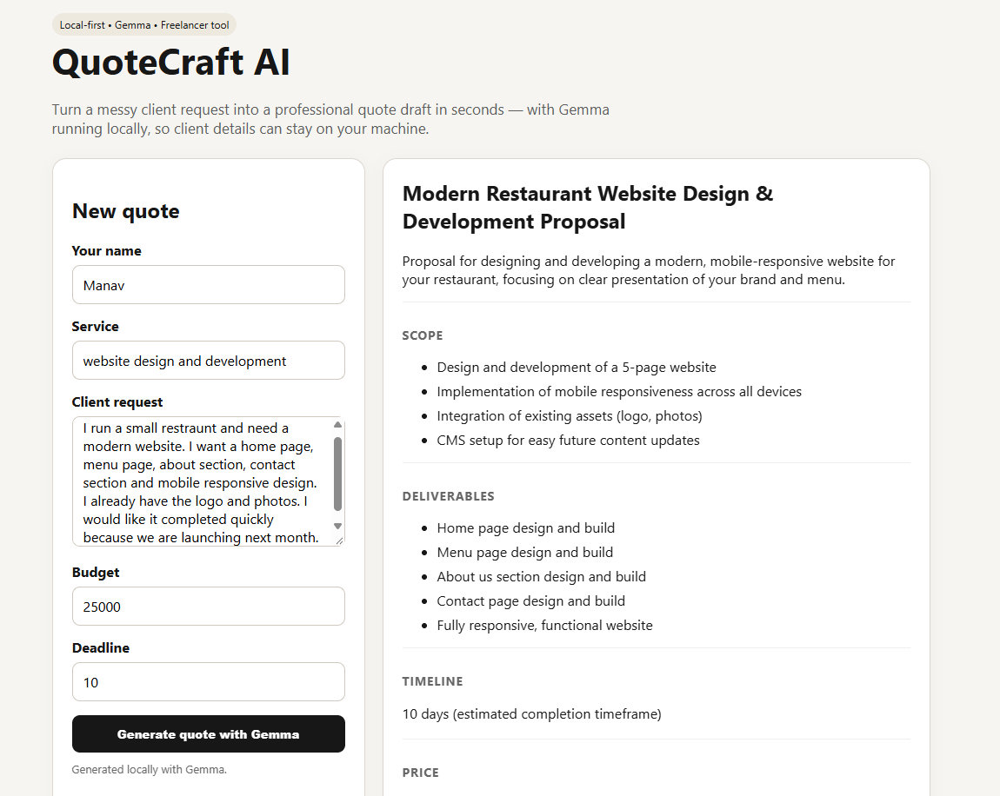

# QuoteCraft AI

**A local-first AI quote generator for freelancers and small service businesses.**

QuoteCraft turns a messy client request into a structured quote draft: scope, deliverables, timeline, pricing note, exclusions, payment terms, and a client-ready message.

## Why open-source AI?

Freelancers often paste private client requirements into hosted AI services. QuoteCraft uses Google's open-weight **Gemma 4 E4B** locally through Ollama, so the draft can be generated on the freelancer's own machine without sending client text to a third-party AI API. Local inference also avoids per-request model charges and keeps the model replaceable.

## Demo

[](https://drive.google.com/file/d/1-FEvWSB5JBfv1WoeFN3z78ffahvghsgJ/view?usp=sharing)

QuoteCraft AI turns a messy client request into a structured, professional quote draft using Gemma 4 E4B running locally through Ollama.

The demo shows the complete workflow:

1. Enter a freelancer's service and client request.
2. Provide the budget and deadline.
3. Generate the quote with local Gemma inference.
4. Review the structured scope, deliverables, timeline, pricing, exclusions, payment terms, and client-ready message.

[Watch the full demo](https://drive.google.com/file/d/1-FEvWSB5JBfv1WoeFN3z78ffahvghsgJ/view?usp=sharing)

## Stack

- Python + FastAPI
- Vanilla HTML/CSS/JavaScript
- Ollama
- Gemma 4 E4B
- Pydantic

## Run locally

### 1. Install and start Ollama

```bash
ollama pull gemma4:e4b
ollama serve
```

### 2. Start the API

```powershell
cd backend
python -m venv .venv
.venv\Scripts\activate
pip install -r requirements.txt
uvicorn main:app --reload
```

### 3. Open the frontend

Open `frontend/index.html` in a browser. The page calls `http://127.0.0.1:8000`.

## Business model

The free local version is a useful lead-in for freelancers. A paid version could add saved client templates, reusable service packages, branded quote PDFs, client history, team workflows, and optional hosted collaboration.

## License

MIT
